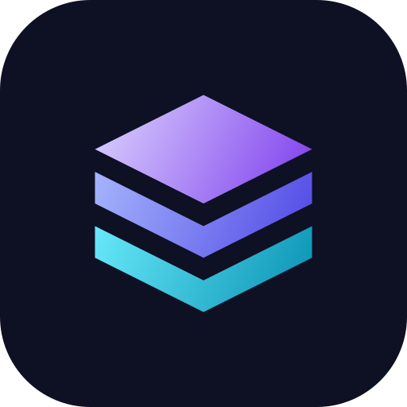

<p align="center"></p>

<h1 align="center">Strata VM</h1>
<p align="center">16, 32 ve 64-bit x86 işletim sistemlerini Android telefonda çalıştır.<br>
<i>Run 16, 32 and 64-bit x86 operating systems on Android.</i></p>

Logodaki üç katman uygulamanın üç modunu temsil eder: **16-bit** (camgöbeği), **32-bit** (çivit), **64-bit** (mor).

## Özellikler
- **VirtualBox tarzı kurulum sihirbazı**: Ad ve işletim sistemi → Donanım → Sanal disk → Özet
- **Tür + sürüm seçimi**: Windows (3.1'den 11'e), Linux (Alpine, Debian, Ubuntu, Arch, Fedora, Mint, Tiny Core, antiX...), DOS, BSD, ReactOS, Haiku, KolibriOS; her sürüm için önerilen donanım
- **Otomatik algılama**: VM adından veya ISO dosya adından sistem türü seçilir
- **Anlık görüntüler** (qcow2): al, geri yükle, sil; VM çalışırken bellek dahil
- **Durumu kaydet ve kapat**: sonraki açılışta tam kaldığın yerden devam eder
- **Paylaşılan klasör**: telefondan eklenen dosyalar VM'de FAT sürücü olarak görünür
- **Klonlama**: VM kopyalanırken disk de bağımsız kopyalanır
- **ISO, IMG, QCOW2, VDI, VMDK, VHD** ve disket desteği; uygulama içinden boş qcow2 disk oluşturma
- **Ekran**: GPU texture ile çizim, iki parmakla yakınlaştırma/kaydırma, keskin veya yumuşak ölçekleme
- **Fare**: dokunmatik (birebir) ve touchpad modu; uzun bas = sağ tık, iki parmak = tekerlek
- **Klavye**: ekran klavyesi + fiziksel klavye, yapışkan Ctrl/Alt/Shift/Win, F1–F12, Ctrl+Alt+Del
- **VM kontrolü**: duraklat/devam, yeniden başlat, ACPI kapatma, çalışırken CD değiştir/çıkar, ekran görüntüsü
- **Ağ**: NAT ile internet, ağ kartı seçimi, port yönlendirme (ör. SSH için `tcp:2222:22`)
- **Arka plan**: VM ön plan servisinde çalışır, bildirimden kapatılabilir
- **Panodan yaz**: telefonda kopyaladığın metni VM'e yazar; yatay ekran kilidi
- **İmaj kütüphanesi**, canlı QEMU günlüğü, Türkçe / English, koyu / açık tema

## Mimari
```
Flutter (lib/)                         Java (android/app/src/main/java/app/strata/vm/)
────────────────                       ─────────────────────────────────────────────
HomeScreen / EditorScreen   ◄─ MethodChannel "strata/backend" ─►  StrataBridge
DisplayScreen (Texture)     ◄─ EventChannel  "strata/events"  ──  Events
                                                                  ├─ VmService    QEMU süreci (ön plan servisi)
                                                                  ├─ QemuCommand  VM ayarı → komut satırı
                                                                  ├─ DisplaySession + RfbClient  VNC → Texture
                                                                  ├─ QmpClient    duraklat, reset, CD değiştir
                                                                  ├─ QemuEnv      ikililer + runtime
                                                                  └─ Store        vms.json, settings.json
```
QEMU ikilileri `jniLibs/arm64-v8a/lib*.so` olarak APK'ya girer (Android 10+ yalnızca `nativeLibraryDir`'den `exec` izni verir). Kütüphaneler ve BIOS dosyaları `assets/qemu-runtime.zip` içindedir, ilk açılışta kurulur. İkisini de `scripts/fetch_qemu_termux.py` Termux deposundan hazırlar.

## Derleme
GitHub'a her push'ta **Actions** APK'yı derler ve **Releases → son-surum** altına `StrataVM.apk` olarak koyar.

Yerelde:
```bash
python3 scripts/fetch_qemu_termux.py
flutter pub get
flutter build apk --release --target-platform android-arm64
```
Flutter 3.24.5 ile test edildi.

## Bilinmesi gerekenler
- Telefonlarda x86 donanım sanallaştırması yoktur, QEMU komutları yazılımla çevirir (TCG). DOS, Win 9x/XP ve hafif Linux akıcı; Windows 7+ yavaştır.
- Ses henüz yok. Aynı anda tek VM çalışır.
- QEMU GNU GPL v2 lisanslıdır; APK'yı dağıtırsan kaynak kodunu da yayınla.
